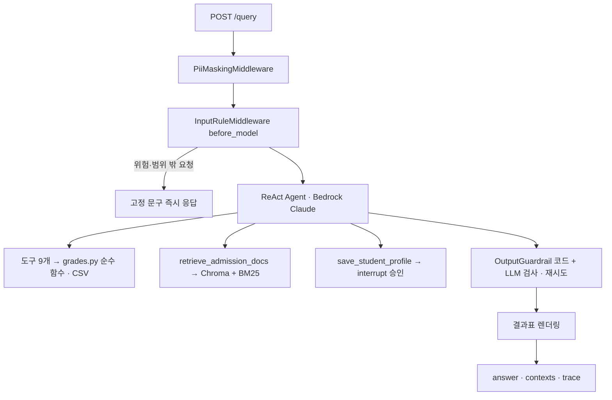

# 미니 PJT: 입시나침반 (가칭)

> 계산·환산·분류는 코드가, LLM은 설명만 담당

## 무엇을 푸나
고1 학기별·과목별 5등급제 내신으로 수도권 4년제·전문대 지원 가능권을 예측하고, 한 단계 위 대학을 위해 어떤 과목을 올려야 하는지 근거와 출처와 함께 알려준다.

> **MVP 데이터 범위:** 간호(4년제 15곳 + 전문대 1곳)와 컴퓨터공학(4년제 11곳) 두 계열. 구조는 학과와 무관하며 같은 방법으로 학과를 늘릴 수 있다. 상세는 [SERVICE.md §6](SERVICE.md).

| 문서 | 내용 |
|---|---|
| [SERVICE.md](SERVICE.md) | 서비스 스펙 (사용자·가치·도구·가드레일·성공 기준) |
| [docs/ARCHITECTURE.md](docs/ARCHITECTURE.md) | 아키텍처·처리 흐름·설계 원칙·패턴 커버리지 |
| [docs/SCREEN_SPEC.md](docs/SCREEN_SPEC.md) | 화면 기획 · API 초안 |
| [docs/DATA_COLLECTION_GUIDE.md](docs/DATA_COLLECTION_GUIDE.md) | 대학 데이터 수집 방법 |

## 제출자 설명
입시나침반은 5등급제 첫 세대 고1 학부모가 자녀 성적으로 수도권 4년제·전문대 지원 가능권을 확인하고, 상위 대학을 위해 보강할 과목을 찾도록 돕는 상담 에이전트입니다. 학기별 성적을 입력하면 평균과 9등급 환산값을 계산하고, 과거 입결과 비교해 상향·소신·적정·안정으로 분류합니다. 계산·환산·분류는 LLM이 아닌 코드가 하고, 전형 정보는 대학 시행계획 RAG로 출처와 함께 답합니다. 합격 보장 표현, 타 학생 정보, 학생부 대리 작성은 모델 호출 전후 가드레일이 막습니다. 평가셋 28건으로 검증했으며, FastAPI 웹 API와 웹 화면으로 실행할 수 있습니다.

## 활용한 패턴 (Day 1~7)
(구현 후 실제 적용분만 남김 — 목표는 [ARCHITECTURE.md §8](docs/ARCHITECTURE.md))
- Day 1: LCEL + Pydantic — 성적 문장 파싱 대체 경로, judge 출력 스키마
- Day 2: RAG — 시행계획·모집요강 하이브리드 검색(Chroma + BM25) + 리랭킹
- Day 3: ReAct — `create_agent` + 도구 9개
- Day 4: 도구 다중 · MCP(선택) — 평균 → 환산 → 입결 → 분류 → What-if
- Day 5: 가드레일 · HITL · 미들웨어 — 입력 규칙 선처리, 출력 검사·재시도, PII 마스킹, 프로필 저장 승인
- Day 6: Multi-Agent Supervisor (선택)
- Day 7: 장기 메모리 · 트레이스 · 평가 — LangGraph Store, TraceMiddleware, LLM-as-Judge + RAGAS

## 아키텍처

상세 흐름은 [docs/ARCHITECTURE.md](docs/ARCHITECTURE.md).

## 눈에 띄는 점
(구현 후 실제 코드 위치와 함께 작성)
- 위험 요청(인젝션·타 학생·대리 작성·보장 문구·범위 밖)은 `before_model` 규칙으로 모델 호출 전에 고정 문구로 끝난다
- 평균·환산·분류·What-if는 `grades.py` 순수 함수, 숫자 표는 도구 결과로 코드가 렌더링 → 모델이 숫자를 지어낼 수 없다
- 대학별 반영 규칙(국영수사·우수 학기 등)을 코드로 적용해 4년제·전문대를 같은 기준으로 비교
- 출력 가드레일 2단(코드 → LLM), 위반 시 1회 재시도 후 고정 거절

## 실행 방법
(개발 후 작성)

## RAGAS 평가 결과
- context_recall: -
- context_precision: -
- faithfulness: -
- answer_relevancy: -

## 인-아웃 세트 통과율 (자체 평가)
- 1차 (Day 9 종료): - / 28 통과
- 2차 (Day 10 개선 후): - / 28 통과
- 개선폭: -

## 트라이앤에러 회고
- 시도했지만 실패한 접근 · 왜 실패했는가
- 최종 채택한 접근 · 왜 그것으로 갔는가
- 남은 한계 · 향후 개선 방향

## 진입점 · 핵심 코드 위치
| 파일 | 역할 |
|---|---|
| `src/api.py` | FastAPI `POST /query` 외 화면용 API, `thread_id`로 대화 유지 |
| `src/agent.py` | `create_agent` 조립, 시스템 프롬프트, 미들웨어 순서 |
| `src/middleware.py` | PII 마스킹, 입력 규칙 선처리, 트레이스 |
| `src/grades.py` | 평균·환산·분류·What-if 순수 함수 |
| `src/data_store.py` | CSV 로드, 학과 키워드 확장, 입결·전형 조회 |
| `src/tools.py` | 도메인 도구 9개 |
| `src/retriever.py` | RAG 파이프라인 |
| `src/guardrails.py` | 출력 가드레일, 결과표 렌더링 |
| `evaluation/run_eval.py` | 평가셋 실행 · LLM 판정 · RAGAS |
