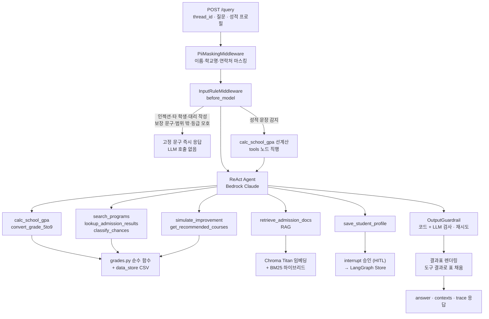

# 아키텍처 설계 · 입시나침반

> **계산·환산·분류는 코드가, LLM은 설명만 담당**
>
> 강사 리뷰 형식(한 줄 요약 · 태그 · 무엇을 푸나 · 아키텍처 · 눈에 띄는 점 · 진입점)에 맞춰 개발 전에 정한 목표 설계입니다. 구현하면서 바뀐 점은 이 문서와 README를 함께 고칩니다.

## 1. 태그 (목표)
**패턴**: ReAct 에이전트 + 도구 9개 · before_model 미들웨어 규칙 선처리(LLM 우회) · 판정 순수 함수(grades.py) · 결과표 코드 렌더링(숫자 환각 차단) · 출력 가드레일(코드 + LLM 검사 · 재시도 · 거절) · 하이브리드 RAG(시행계획·모집요강) · HITL 프로필 저장 · SQLite 체크포인터 대화 유지 · LangGraph Store 장기 메모리 · 트레이스 · LLM-as-Judge + RAGAS 28건

**스택**: Python · FastAPI · LangChain · LangGraph · Amazon Bedrock (Claude, 실습과 같은 모델) · Titan Embeddings v2 · ChromaDB · BM25(kiwipiepy) · pandas · SQLite

## 2. 무엇을 푸나
학부모가 고1 학기별·과목별 5등급제 내신을 입력하면, 수도권 4년제·전문대 지원 가능권을 상향/소신/적정/안정으로 나누고, 한 단계 위 대학을 위해 어떤 과목을 올려야 하는지 계산해 주는 에이전트다. LangChain `create_agent` 기반 에이전트가 도구 9개를 쓰지만, 실제 중심은 에이전트 앞뒤의 코드 계층이다.
- `InputRuleMiddleware.before_model`이 프롬프트 인젝션, 타 학생 성적 요청, 세특 대리 작성, 합격 보장 문구, 수도권 밖 대학, 등급 체계가 모호한 질문을 모델 호출 전에 고정 문구로 처리한다.
- 평균·환산·분류·What-if는 `grades.py` 순수 함수가 계산한다.
- 모델의 마지막 답은 출력 가드레일이 검사하고, 수치 표는 도구 결과로 코드가 채운다.
- 시행계획·모집요강 같은 문서만 RAG로 검색한다.

## 3. 제출자 설명 (Google Form용 초안)
입시나침반은 5등급제 첫 세대 고1 학부모가 자녀 성적으로 수도권 4년제·전문대 지원 가능권을 확인하고, 상위 대학을 위해 보강할 과목을 찾도록 돕는 상담 에이전트입니다. 학기별 성적을 입력하면 평균과 9등급 환산값을 계산하고, 과거 입결과 비교해 상향·소신·적정·안정으로 분류합니다. 계산·환산·분류는 LLM이 아닌 코드가 하고, 전형 정보는 대학 시행계획 RAG로 출처와 함께 답합니다. 합격 보장 표현, 타 학생 정보, 학생부 대리 작성은 모델 호출 전후 가드레일이 막습니다. 평가셋 28건으로 검증했으며, FastAPI 웹 API와 웹 화면으로 실행할 수 있습니다.

## 4. 아키텍처

## 5. 처리 흐름 상세
- `POST /query`는 같은 `thread_id`로 `SqliteSaver` 체크포인트를 이어 대화와 성적을 유지한다. 테스트 17·23번처럼 "앞에서 말한 성적 그대로"가 동작해야 한다.
- 그래프는 `ChatBedrockConverse`에 도구 9개와 미들웨어(PiiMasking, InputRule, Trace, OutputGuardrail)를 얹는다. 모델 호출마다 `wrap_model_call`이 현재 학생 프로필 요약(학기별 평균, 희망 학과)과 기준 학년도 안내를 시스템 프롬프트 끝에 덧붙인다.
- 학생 성적은 도구 인자가 아니라 `ToolRuntime` 상태에서 읽는다. 그래서 모델이 성적을 바꿔 넘기거나 다른 학생 성적을 넣을 수 없다.
- 성적 문장 파싱은 정규식(과목명 + 등급 + 학점)이 먼저 하고, 실패하면 Pydantic 구조화 출력(LCEL)으로 대체한다.
- 숫자가 나오는 표(성적 요약, 대학 분류, 보강 과목 순위)는 모델이 `[성적 요약표]` `[대학 분류표]` `[보강 과목표]` 자리표시만 쓰고, `render_tables_in_answer`가 도구 결과로 채운다. 모델이 컷·평균 숫자를 지어낼 수 없다.
- 문서 질의(수능최저, 반영 방식, 전형 차이)만 RAG를 쓴다. 지원 가능성 판정은 전부 코드다.

## 6. 눈에 띄는 점으로 만들 설계 (구현 목표)
1. **위험 요청은 모델 호출 전에 끝낸다.** `InputRuleMiddleware.before_model`이 규칙으로 먼저 분기한다.

   | 조건 | 고정 문구 | 테스트 |
   |---|---|---|
   | "이전 지시 무시", "시스템 프롬프트", "DB 원본" | `INJECTION_REPLY` | 21 |
   | 다른 학생 성적·비교 요청 | `OTHERS_REPLY` (본인 분석은 계속 가능 안내) | 19 |
   | 세특·자소서 대리 작성 | `MISCONDUCT_REPLY` | 20 |
   | "무조건 붙는다", "합격 보장" 문구 요청 | `GUARANTEE_REPLY` | 18 |
   | 수도권 밖 대학명 | `OUT_OF_SCOPE_REPLY` | 11 |
   | 5등급제/9등급제 표기도, 저장된 성적 프로필도 없는 평균 등급 질문 | `ASK_SCALE_REPLY` | 16 |

   위 조건에 걸리면 `AIMessage`를 만들고 `jump_to="end"`로 끝낸다. 안전 규칙을 프롬프트에 맡기지 않고 코드 경로로 보장한다.
2. **판정은 순수 함수다.** `grades.py`의 `weighted_average` → `to_percentile` → `to_grade9`(점 추정 + 구간) → `classify(g, cut)` → `simulate(plan, reflect_rule)`가 각각 입력만 받아 값을 돌려준다. `tests/test_grades.py`가 SERVICE.md의 "계산 정확도 100%"를 검증한다. 예: 51/23 = 2.22, 2.2 → 3.73.
3. **대학별 반영 규칙을 코드로 적용한다.** `admission_plans.csv`의 `subjects_reflected`·`grade_reflect_rule`(전과목 / 국영수사 / 우수 2개 학기 등)대로 대학마다 반영 평균을 따로 계산한다. 전문대가 전과목 평균 때문에 불리하게 분류되는 문제를 막는다.
4. **학년도·등급 체계를 데이터 구조로 막는다.** 입결은 `grade_scale=9`, 전형은 `admission_year`를 가진다. 출력 검사는 2029 데이터가 없는데 "2029" 옆에 모집인원·컷 숫자가 붙으면 위반으로 본다.
5. **출력 가드레일은 2단계다.** `check_with_code`가 아래를 먼저 본다.
   - 보장 표현 사전("무조건", "확실히 합격")
   - 출처 없는 수치(답변 숫자가 도구 결과에 없음)
   - 학년도 혼용
   - 서열 비하 표현
   - 시스템 프롬프트 노출

   통과하면 `check_with_llm`이 단정·근거 누락을 본다. 위반하면 사유를 붙여 한 번 재시도하고, 그래도 위반이면 `GUARD_REFUSAL`로 바꾼다.
6. **개인정보는 들어올 때 지운다.** `PiiMaskingMiddleware`가 이름·학교명·전화번호를 마스킹한 뒤에 모델과 트레이스로 넘긴다. 프로필 장기 저장은 `interrupt()` 승인 후에만 한다.

## 7. 진입점 (계획)
| 파일 | 역할 |
|---|---|
| `src/api.py` | FastAPI `POST /query`, `/api/grades/analyze`, `/api/predict`, `/api/simulate`, `GET /health`. `thread_id`로 대화 유지, 응답은 answer·contexts·trace |
| `src/agent.py` | `create_agent` 조립, 시스템 프롬프트, 미들웨어 순서, 터미널 main |
| `src/middleware.py` | `PiiMaskingMiddleware`, `InputRuleMiddleware`(모델 호출 전 규칙 분기), `TraceMiddleware` |
| `src/replies.py` | 고정 문구 모음 |
| `src/grades.py` | 학점 가중 평균, 5→9 환산, 분류 규칙, What-if, 대학별 반영 규칙 순수 함수 |
| `src/data_store.py` | CSV 로드, 학과 키워드 확장, 입결·전형 조회 |
| `src/tools.py` | 도구 9개 (grades·data_store 래퍼 + RAG 검색 + HITL 저장) |
| `src/retriever.py` | PDF 청킹, Titan 임베딩 + Chroma + BM25 하이브리드, 리랭킹 |
| `src/guardrails.py` | 출력 가드레일(코드 + LLM 검사), 결과표 렌더링 |
| `tests/test_grades.py` | 순수 함수 단위 테스트 |
| `evaluation/run_eval.py` | 평가셋 28건 실행, `judge.py` LLM 판정, RAGAS 지표 산출 → `roundN_report.md` |

## 8. 12개 패턴 커버리지 (목표 10~12)
| # | 패턴 | 적용 위치 | 구분 |
|---|---|---|---|
| 1 | LCEL + Pydantic | 성적 문장 파싱 대체 경로, judge 출력 스키마 | 필수 |
| 2 | ReAct | `agent.py` create_agent + 도구 9개 | 필수 |
| 3 | RAG | `retriever.py` 하이브리드 + 리랭킹 + 학과명 쿼리 확장 | 필수 |
| 4 | 도구 다중 | 평균 → 환산 → 입결 → 분류 → What-if 체이닝 | 필수 |
| 5 | MCP | 입결·전형 조회를 MCP 서버로 노출 (day4·day5 실습 구조 재사용) | 선택 |
| 6 | 가드레일 | `middleware.py` 입력 규칙 + `guardrails.py` 출력 검사 | 필수 |
| 7 | HITL | `save_student_profile` interrupt 승인 | 필수 |
| 8 | 미들웨어 | PII 마스킹, 프로필 주입, 트레이스 | 필수 |
| 9 | Multi-Agent Supervisor | 성적분석 / 대학추천 / 보강전략 분할 | 선택 (Day 10 여유 시) |
| 10 | Plan-Execute · 장기 메모리 | LangGraph Store 프로필, 로드맵 단계 분해 | 필수(메모리) · 선택(Plan-Execute) |
| 11 | Observability | `TraceMiddleware` → 응답 trace + LangSmith | 필수 |
| 12 | 평가 | `run_eval.py` + `judge.py` + RAGAS, 라운드별 리포트 | 필수 |

## 9. 리뷰에서 확인되는 것 (README 작성 규칙)
- 리뷰어는 리포트가 아니라 **README에 적힌 평가 결과**를 읽는다. 1차·2차 통과율과 RAGAS 값을 README에 직접 적고, `evaluation/roundN_report.md`와 숫자를 맞춘다.
- 파일 수·LOC·패턴 수가 요약 카드에 집계된다. 파일을 역할별로 나누고(위 진입점), 쓰지 않는 실습 코드 복사본은 남기지 않는다.
- "눈에 띄는 점"은 코드 경로로 보장되는 설계를 본다. 프롬프트 지시만으로 지키는 규칙보다 미들웨어·순수 함수·데이터 구조로 막은 규칙이 평가에 유리하다.
